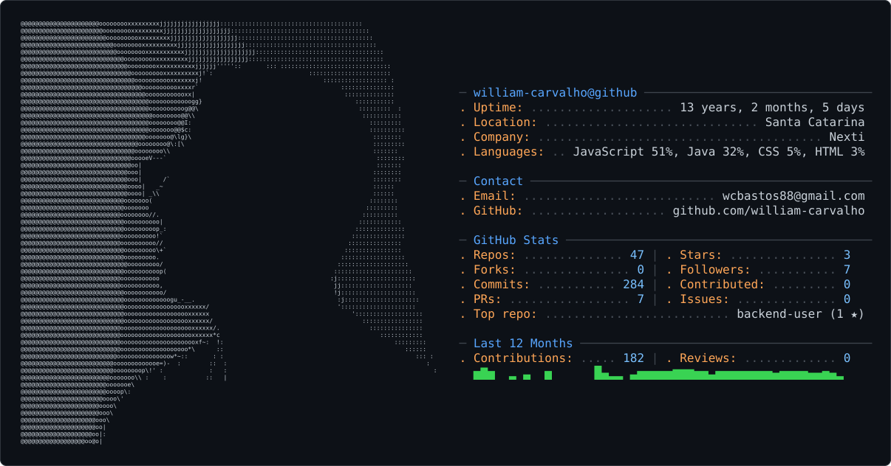

<picture>
  <source media="(prefers-color-scheme: dark)" srcset="dark_mode.svg" />
  <source media="(prefers-color-scheme: light)" srcset="light_mode.svg" />
  
</picture>

💜 I'm Will! 👋

  <strong>Software Engineer • Technical Leadership • Java • AWS • Distributed Systems • SaaS • AI Adoption</strong>

  Building reliable software at scale.

📊 GitHub Overview

  
  

  

🧭 Profile Summary

  

  
  

  

---

## 🧠 Tech Stack

### Backend & Languages

### Frontend & Mobile

### Distributed Systems & Data

### ⚙️ DevOps, Cloud & Observability

### 🧩 Product, Business & Collaboration

### 💻 Tools & IDEs

---

## 🎧 Beyond Code

---

## 🌐 Connect

<!-- Add your real links before publishing these badges:

-->
